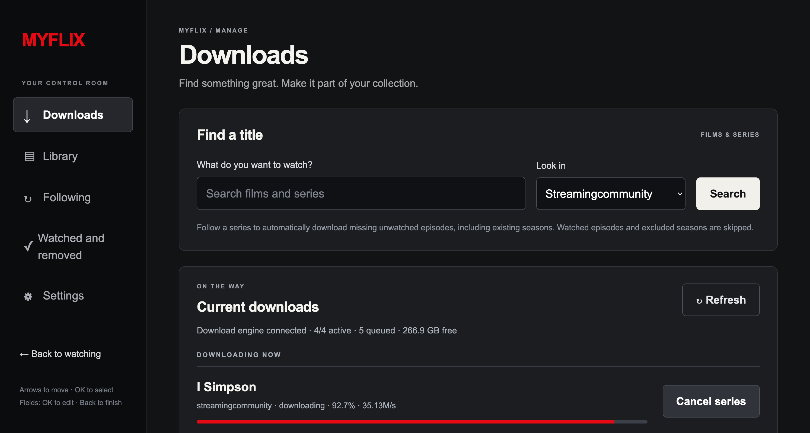

# MyFlix

**Your home video library, with a streaming-app feel.**

MyFlix turns a folder of films and series into a TV-friendly library with cover art, continue watching, and automatic next episodes. Built for a Raspberry Pi and the browser on a VIDAA TV, it brings watching, catalog management, and downloads together in one small service.


[Get started](#get-started) · [Add your media](#add-your-media) · [Run on Raspberry Pi](#run-on-raspberry-pi) · [Detailed guide](docs/guide.md)

## Why MyFlix?

- **Made for the sofa.** Browse horizontal shelves with your remote, open seasons and episodes, and watch in an edge-to-edge player whose controls fade away.
- **Pick up where you left off.** Resume across household devices, track watched episodes automatically, and move to the next episode without leaving fullscreen. The next-episode prompt focuses its button when it appears, so pressing OK starts the next episode immediately.
- **Manage everything in one place.** Search providers, queue downloads, edit titles, organize series, and choose your library folder from the built-in admin interface.
- **Keep up with series.** Follow a show to download missing unwatched episodes from existing and future seasons, or choose notification-only mode. Watched episodes and excluded seasons are skipped automatically.
- **Covers without API keys.** MyFlix uses local artwork first and caches provider covers in the background when available.
- **Details from your download source.** Film and series pages show available synopses, genres, cast, year, and episode details, with runtime read from the local video.
- **Discover what to watch next.** SIMKL shelves show weekly most-watched series and home-released films, plus upcoming series and seasons. Hover or focus artwork to preview a trailer with sound when the browser permits it.
- **A small stack to maintain.** One systemd service, SQLite, plain HTML/CSS/JavaScript, and native browser video. No containers, Redis, Node build, or playback transcoding service.

[VibraVid](https://github.com/AstraeLabs/VibraVid) is bundled as the download engine. MyFlix installs a pinned revision, starts and stops it, and publishes completed downloads into your selected library. You do not need to configure a separate engine website, port, or shared secret.

The current pin is VibraVid **1.5.0**, including upstream Referer-header fixes for StreamingCommunity/VixCloud requests. Provider HTTP 403 responses can still depend on upstream availability and access requirements.

## Manage your collection



The admin interface works with a desktop pointer or TV remote. Use **Downloads** to find titles and manage the queue, **Library** to edit your collection, **Following** to monitor series, and **Settings** to select storage and download limits. **Watched and removed** keeps history accessible after video files are removed.

## Get started

For an always-on Raspberry Pi installation, use **64-bit Raspberry Pi OS** and follow [Run on Raspberry Pi](#run-on-raspberry-pi); `install.sh` installs the required tools for you.

For local development, you need [mise](https://mise.jdx.dev/), Git, and network access. Mise installs the pinned Python and uv versions; no global Python changes are needed.

```sh
git clone https://github.com/cmunaro/MyFlix.git
cd MyFlix
mise trust
mise install
mise run setup
mise run dev
```

Setup fetches the pinned VibraVid source and installs the frozen Python dependencies. Start commands from the project root.

| Open | Address |
| --- | --- |
| Watch on this computer | `http://localhost:8090` |
| Manage the library and downloads | `http://localhost:8090/admin` |
| Watch on your TV | `http://<server-LAN-IP>:8090` |

Connect the TV to the same home network, open the TV address in its browser, and bookmark it. Replace `<server-LAN-IP>` with your server's local IP address. Keep MyFlix running while watching or downloading.

**Trusted home LAN only:** admin is password-free. Anyone who can reach MyFlix can manage the library and downloads. Do not port-forward it; use a VPN or an authenticated TLS reverse proxy for remote access.

## Add your media

1. Open **Admin → Settings** and choose an **existing absolute path** to your video folder. A default `data/library/` folder is created for you.
2. Copy completed videos into that folder, or use **Downloads** to search a provider and queue a film or episodes. Keep the library separate from the engine's download staging folder.
3. Scan from **Library**, or wait for the background scan, which runs every 60 seconds. Files must be non-empty and at least 60 seconds old before import.
4. Return to the TV home screen to browse and play. Refresh the page to see newly imported titles or covers.

MyFlix recognizes MP4, M4V, MKV, WebM, and MOV files. Episode names such as these are detected automatically:

```text
The.Show.S01E02.Episode.Title.mp4
The.Show.1x03.Episode.Title.mp4
```

Correct unusual names and metadata in **Library**. Local JPEG artwork is supported, including `poster.jpg`, `fanart.jpg`, and `<video>-poster.jpg` sidecars. Provider artwork fills gaps when a confident match is available; otherwise titles get a text-based cover.

Catalog edits and watch progress survive rescans and missing files. An unavailable mount preserves the previous catalog and reports a scan error. Removing a video through admin deletes its library file but keeps its catalog details and watch history; sidecars and staging originals remain.

### Follow a series

In **Downloads**, find a series, set **Library series name** to its existing catalog name if applicable, and select **Follow series**. MyFlix checks all seasons every four hours while running. **Save & check now** schedules an earlier check, normally within about 30 seconds. Both **Downloads → Followed series checks** and **Following** show live lookup status: queued, fetching, complete, or failed. During fetching, the season count, current season, and episodes found update automatically every three seconds when the provider exposes season progress; otherwise an indeterminate progress bar remains visible. Loading all seasons of a long-running series can take several minutes; episode lookups allow up to five minutes before reporting a timeout. Errors stay visible with **Save & check now** available in Following.

Following can catch up on existing episodes as well as discover new ones. In **Following**, pause monitoring or choose notification-only mode. Use **mark a season watched & exclude downloads** to skip seasons you have already seen. Notifications stay inside MyFlix.

Single-episode download requests queue without repeating the all-season lookup; the download worker resolves the requested episode. Season and episode-range selections retain the engine's metadata expansion.

Failed downloads appear with season, episode, and error details in Downloads. Following retains confirmed episode failures and provides a **Retry failed episode** action. **Retry all failed downloads** moves eligible failures out of Recent failures into a persistent priority queue. Retries start ahead of ordinary queued downloads, while running jobs finish normally. A retry that fails again returns with its new error. After each server restart, MyFlix automatically queues confirmed eligible failures once, after the first successful library scan. Failures from that recovery remain visible until you retry them or restart again. If a download request times out, check the queue before retrying. MyFlix does not automatically retry uncertain download submissions. Provider availability, accounts, and any required optional modules depend on the upstream provider.

Acknowledged film and single-episode downloads interrupted by a reboot or service restart are recovered automatically after the engine is ready and the library has been scanned. MyFlix records which engine accepted each request and queues missing eligible work with priority, keeping the simultaneous job limit. Existing files, queued jobs, completed or cancelled requests, watched/excluded episodes, and paused or notification-only follows are skipped. Episode ranges and requests with uncertain outcomes still require queue review before retrying.

## Use your TV remote

Desktop browsers with a mouse or trackpad show arrows over blurred panels when you hover a thumbnail shelf, including season episode lists. Each click browses a page of titles with some overlap. The arrows also support keyboard focus. TV browsers, including TVs with a connected mouse, and touch-only browsers do not receive these controls. During desktop playback, double-click the video to enter or exit fullscreen. Move the mouse to reveal the controls, then click anywhere on the progress bar to jump to that time; dragging the seek handle also works. You can seek beyond the data already buffered in the browser: the browser requests that part of the file immediately, and a Loading overlay stays visible until the requested frame is ready. Paused playback stays paused after seeking.

| Input | Action |
| --- | --- |
| Arrow keys / D-pad | Move through shelves, episodes, and controls |
| OK / Enter | Select; toggle playback when the video has focus |
| Left / Right with video focused | Seek backward / forward 10 seconds |
| Up / Down during playback | Access player controls |
| Back during playback | Close the track chooser, exit fullscreen, dismiss controls, then return to the library as applicable |
| OK / Back in an admin field | Start / finish editing |

Playback controls hide after three idle seconds while playing, even if a button had focus. Pause keeps them visible. On desktop, hovering over the progress bar previews the timestamp at the pointer; clicking or dragging seeks to that position. Near an episode's end, a separate next-episode prompt appears; playback advances automatically at completion when another available episode exists. Progress is shared by the household, with no separate user profiles. Series in **Continue watching** stay out of **Not watched**. Every partially watched library thumbnail shows a red playback progress line along its bottom edge, including episode thumbnails; watched titles show a full red line. Resume badges stay in Continue watching.

MyFlix automatically checks episode endings using text presence. A low-priority worker extracts a frame one minute before the end and checks for letter-sized shapes using adaptive contrast; a single line of names counts, including gold or dim lettering and dark text on a light background. If text is present, it searches earlier, starting 30 seconds back and expanding that distance until it finds a frame without text. If absent, it searches closer to the end. Once it brackets a transition from no text to text, it bisects until the interval is at most three seconds wide and uses the later edge as the timestamp. There is no word recognition, language requirement, extra confirmation frame, or three-minute search cutoff. Only individual frames are extracted, and credits over animation are supported.

Results, including inconclusive results, are cached in SQLite and invalidated when the file's path, size, modification time or detector version changes. For new downloads, detection is part of final processing: MyFlix analyzes the hidden completed copy and commits its final-path timestamp before publishing the video. The job remains in **Processing** and retains its job and processing slots until publication finishes. Films skip episode-credits analysis. A single analysis lock also covers background backfill of existing files, where recently played episodes take priority. Scanning reuses the precomputed timestamp without another analysis. No frames leave the Pi and original videos are never modified. Seek speed and video encoding affect analysis time. The timestamp is loaded when opening or advancing to an episode. Missing tools, failed extraction, or inability to bracket a text transition retain the final-30-seconds prompt (final 10% for short videos). Inconclusive detection is logged and does not fail a valid download. Automatic advancement still waits for the file to finish, preserving any extra scenes during credits.

Detection uses Pillow and installed FFmpeg/FFprobe executables or the bundled engine's downloaded tools. No OCR engine, API keys or extra service are needed. Bisection assumes text remains present after credits begin. Subtitles, signs, gaps between credits cards and extra scenes can break that assumption; the three-second interval is a sampling tolerance, not a guaranteed error relative to the true credits start. Stylized text can also be missed by the image check.


In **Library**, expand a series, then a season to see its episodes. Each episode row has **Mark as watched** (or **Mark as unwatched**) before its availability label; use it without opening the episode editor. Marking watched fills the red progress line in the TV library. Marking unwatched clears it and restarts playback from the beginning.

Audio and subtitle selection appears when the browser exposes suitable native tracks. Subtitles start off for each video. External subtitle files are not imported.

### Library title details

Select a film to open its detail page, then choose **Play** or **Resume**. Series pages include available title information, season descriptions, and episode titles/descriptions. Continue watching and the featured Play action still open playback directly.

A background worker retrieves metadata from the download provider and saves it in SQLite. Saved download requests and followed series identify the original source; for other library files, MyFlix accepts only a single provider search result matching the title, media type, and filename year when present. Ambiguous results remain without provider details. No external metadata service, account, or API key is added. StreamingCommunity title pages and providers exposing the bundled engine's common series scraper are supported; other providers contribute explicit metadata already present in their search payload. Availability/pricing notices are never used as synopses. Field coverage varies by provider, and unsupported fields are omitted.

Metadata refreshes every seven days, or when a new library season or saved source is found. Provider failures retain saved details and retry after an hour. FFprobe reads each local video's actual runtime at low priority with a 15-second timeout; unavailable tools or unreadable files leave runtime blank and retry after an hour. Changes to the file path, size, or modification time invalidate the cached runtime. Neither providers nor FFprobe are called while serving web pages. Refresh the page after background processing to see new details.

Catalog titles and watch history are never overwritten by this worker. Provider episode names supplement filename-inferred titles on series shelves; manually edited titles take precedence. Cached details survive restarts, rescans, removed files, and engine download-history cleanup. SQLite backups include these details.

### Discovery and trailers

Discovery uses public SIMKL JSON feeds without an account or API-key entry. Rankings refresh daily; the TV calendar refreshes every six hours. Refresh the home page to see updates. Failed requests retain the last successful results and retry after an hour. These credential-free endpoints work currently; upstream access requirements can change. Rankings reflect SIMKL viewers, not worldwide streaming totals. The most-watched film shelf requires an existing home-release date, which may include physical releases and does not guarantee Italian streaming availability. Upcoming series includes season premieres; there is no upcoming home-release shelf.

Discovery cards open details with a **Find in Downloads** search; they do not add catalog entries or start downloads. Selected rows center their full height, including headings and captions. Artwork loads from SIMKL. The home page includes the first available trailer iframe directly in its initial HTML with eager loading, outside the hidden preview panel. The browser starts loading it while parsing the page, before deferred scripts execute; the YouTube API attaches to that same iframe without navigating it again. This initializes the player but does not prebuffer a video stream, so YouTube buffering still contributes to startup time. After 250 ms of hover or remote focus, that same player attempts playback with sound; switching titles reuses the iframe instead of loading YouTube again. If the browser blocks sound, MyFlix retries muted and enables sound on the next key press, click, or touch when permitted. The browsing UI stays visible for three seconds after the last input or selection, then fades out over two seconds only while the selected trailer is playing. Trailer startup does not reset that deadline. Movement and interactions bring the UI back quickly and restart the three-second countdown. Focus stays on the selected card. Changing selection, leaving the page, or hiding the tab stops the preview. Reduced-motion preferences disable autoplay. Missing, blocked, or unplayable trailers retain artwork with a status message. YouTube receives requests while the home page warms the player, even before a card is selected, and may show its own branding. Reduced-motion preferences prevent API startup and remove the preloaded iframe when JavaScript initializes; the browser may already have begun fetching that iframe from the initial HTML. Automatic previews are for discovery cards; library playback and watch progress remain separate.

Browser autoplay policy, trailer availability, and VIDAA firmware can prevent previews. Test on the physical TV; a seamless Netflix-identical experience is not guaranteed.

### Playback compatibility

MyFlix plays video using the TV's native codecs. **MP4 with H.264 video and AAC audio at 720p or 1080p is the recommended starting point.** A file appearing in the library does not guarantee that your TV can decode it. There is no playback transcoding, automatic codec conversion, or DRM handling.

For MKV/WebM files whose seek index is referenced only by a second Matroska seek header, MyFlix exposes that index in the first header during delivery. This lets Firefox request unbuffered positions directly. Library files, media offsets, and encoded audio/video remain unchanged; no conversion or extra tool is required.

VIDAA firmware controls its own browser bars, pointer, and fullscreen behavior. MyFlix requests fullscreen and supports remote navigation, but cannot guarantee that native browser overlays disappear. Test playback, seek, resume, audio, and remote keys on your actual TV. **Physical VIDAA and Raspberry Pi validation has not been performed.**

## Run on Raspberry Pi

On **64-bit Raspberry Pi OS**, clone the repository anywhere as your normal user, then run:

```sh
git clone https://github.com/cmunaro/MyFlix.git
cd MyFlix
./install.sh
```

The [install script](install.sh) uses sudo, installs OS prerequisites and a private mise installation, installs the pinned Python/uv and bundled engine, creates the service account, and enables and starts MyFlix at boot. You only need Git and sudo to begin. Setup needs network access. The checkout must be clean; only committed files are deployed.

| Location | Purpose |
| --- | --- |
| `/opt/myflix/current` | Active release (symlink); independent of your clone |
| `/opt/myflix/releases/` | Prepared and previous releases |
| `/opt/myflix/.mise-data` | Pinned tools shared between releases |
| `/etc/myflix.env` | Listening address and port; preserved on reinstall/update |
| `/var/lib/myflix` | Databases, settings, artwork cache, and engine staging |
| `/srv/media/library` | Completed videos |

After installation, select `/srv/media/library` in admin. For another mount, use `sudo systemctl edit myflix` to override `RequiresMountsFor` and `ReadWritePaths`, then restart and change the admin library setting. The service user needs read/write access; media under `/home` is blocked by `ProtectHome`. Existing media folders and their permissions are preserved.

Update from your original clone:

```sh
./update.sh
```

The [update script](update.sh) refuses local changes, runs `git pull --ff-only` against your branch's upstream, prepares dependencies in a separate release, stops MyFlix, switches releases, and starts it again. Playback and downloads are interrupted during the restart. It checks HTTP health before reporting success. If preparation fails, the old service keeps running; if startup fails, it switches back to the previous release and attempts to restart it. State and media are preserved; back up state before upgrading because code rollback does not undo database changes.

Old and failed release folders remain for recovery. Once an update is confirmed, you can remove unused folders under `/opt/myflix/releases/`; keep the target of `current` and the previous working release. Re-running `install.sh` deploys the current commit without pulling. Existing installations directly in `/opt/myflix` require manual migration before using these scripts. See the [operating guide](docs/guide.md#raspberry-pi-service).

```sh
sudo systemctl status myflix
sudo journalctl -u myflix -f
curl http://127.0.0.1:8090/health
```

Job and processing limits are configurable in **Settings** and apply after restart. **Simultaneous jobs** caps all working jobs combined: downloading, waiting for processing, processing, and saving to the library. Defaults are four total jobs, with at most one processing at a time. Higher limits use more RAM, bandwidth, and temporary disk space; tune them for your hardware. Engine helper binaries are obtained on demand, and their availability on Raspberry Pi needs validation on the target.

## Data, backups, and updates

Local runs store state under `./data` by default; set `MYFLIX_DATA` to use another location. `MYFLIX_HOST` and `MYFLIX_PORT` control the listening address and port, defaulting to `0.0.0.0:8090`.

SQLite stores catalog edits, settings, follows, exclusions, and household watch history. Completed media is copied into the library folder chosen in admin as independent files, without hard links or symbolic links to staging. Successful downloads are published atomically; existing videos are never overwritten. Staging originals remain and can continue to occupy disk space.

On Linux, library drives using exFAT are supported through an atomic no-replace rename after copying the completed file. The library drive must be mounted read/write. If it becomes read-only, check the filesystem and mount before retrying publication; completed downloads remain in staging.

To back up, stop MyFlix and copy the entire data directory, including any SQLite `-wal` and `-shm` files, then restart. Back up media separately. Keep backups private: the data directory also contains internal secrets and provider login files.

Before updating, back up state, then run `./update.sh` from your clone. The script handles the pinned tools, dependencies, and service restart. See the [operating guide](docs/guide.md#tests-and-backup) for more detail.

## Contribute

Start with the [contributor instructions](AGENTS.md) and keep changes suited to a Raspberry Pi and TV browser: native playback, visible remote focus, ES5 JavaScript, and a single service.

```sh
mise run setup
mise run test
mise run test-tv
```

The Python suite covers catalog behavior, security boundaries, the engine lifecycle, and download publication. TV tests cover navigation and player behavior with DOM fixtures; the test task pins its own Node version, while production requires no Node runtime. These checks do not replace testing on physical hardware.

For bug reports, include the server OS, TV model and firmware, steps to reproduce, and relevant logs. For playback problems, include the container and audio/video codecs. Remove credentials and internal tokens from logs before sharing.

## Further reading

- [Setup and operating guide](docs/guide.md) — detailed behavior and configuration.
- [Following series and watch history](docs/guide.md#following-series-and-keeping-history).
- [Artwork lookup and caching](docs/guide.md#automatic-covers).
- [VibraVid integration, storage, and processing](docs/guide.md#vibravid-integration).
- [VIDAA browser and codec limitations](docs/guide.md#tv-compatibility).

VibraVid retains its upstream **GPL-3.0-or-later** license; its source and license are included in the pinned checkout.
